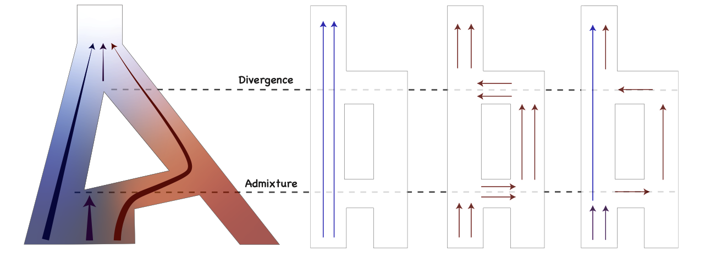

# AdmixIBD

**Reference-free inference of population admixture history from identity-by-descent (IBD) segments**



*Conceptual illustration of divergence, admixture, and ancestry-related IBD patterns.*

## Overview

AdmixIBD is a research-stage computational method for inferring aspects of population admixture history from identity-by-descent (IBD) segments, without requiring predefined ancestral reference populations.

The provided implementation combines information from the distribution of IBD segment lengths with an IBD-sharing constraint. It estimates parameters under the model implemented in `AdmixIBD.py` using numerical optimization. The current release contains the main Python script, example input parameters and IBD segment lengths, an example result, and supplementary population-level data derived from the 1000 Genomes Project (KGP).

> **Research software notice:** This repository contains a research implementation. Review the model assumptions, parameter settings, and units carefully before applying it to new datasets.

## Repository structure

```text
AdmixIBD/
├── AdmixIBD.py
├── README.md
├── requirements.txt
├── docs/
│   └── AdmixIBD_schematic.png
├── examples/
│   ├── input_par.json
│   ├── input.IBDlength_cM.txt
│   └── result.json
└── KGP/
    ├── IBDFiles.zip
    ├── AdmixtureSignals.xlsx
    └── IBD_sharing_values_AdmixRatio.csv
```

## Installation

Python 3 is required. Install the dependencies in a Python environment:

```bash
python -m pip install -r requirements.txt
```

The required packages are `numpy`, `scipy`, and `nlopt`.

## Quick start

From the **repository root**, run:

```bash
python AdmixIBD.py \
  --par-path examples/input_par.json \
  --result-path examples/new_result.json
```

The command reads model settings from `examples/input_par.json`, loads the IBD length data specified by `data_path`, and writes its output to `examples/new_result.json`.

**Important:** In `examples/input_par.json`, ensure that the `data_path` field points to the example input using a path relative to the repository root:

```json
"data_path": "examples/input.IBDlength_cM.txt"
```

The script currently resolves this path relative to the working directory, not relative to the JSON configuration file.

## Input files

### IBD segment lengths

`examples/input.IBDlength_cM.txt` contains **one IBD segment length per line**, in centimorgans (cM). The implementation converts the lengths to Morgans by multiplying by `0.01`.

### Model configuration

`examples/input_par.json` contains the optimization settings, including:

| Field | Description |
| --- | --- |
| `data_path` | Path to the IBD segment-length input file |
| `ibd_label` | Observed IBD-sharing value used by the objective |
| `N_hap_bound`, `tau_a_bound`, `m_bound` | Bounds for model parameters |
| `init_par` | Initial parameter values in the order `N_hap`, `tau_a`, `m` |
| `fix` | Whether each parameter is free (`0`) or fixed (`1`) |
| `fix_val` | Values of fixed parameters |
| `gamma`, `beta` | Weights of the IBD-sharing and length-distribution terms |
| `rep` | Replicate setting; use `[1]` for the supplied example |

The objective combines a negative log-likelihood term for IBD segment lengths with a squared-error term for IBD sharing. For precise definitions of the parameters and mathematical assumptions, consult the research manuscript and source code.

## Output

The program writes a JSON file containing parameter estimates and optimization diagnostics for sequential rounds, including `round0`, `round t1`, and `round mn1`. The supplied `examples/result.json` illustrates the output format.

Some result keys retain the spelling `aproximated` to remain consistent with the current implementation.

## KGP data

The `KGP/` directory provides supplementary population-level material, including a table of IBD-sharing values and admixture ratios, an Excel workbook, and an archive of IBD files. These files are **not automatically loaded** by the quick-start command.

## Citation

A manuscript describing AdmixIBD is in preparation. Citation details will be added when available.

## License

No software license has been specified for this repository. Please contact the authors regarding reuse or redistribution.
